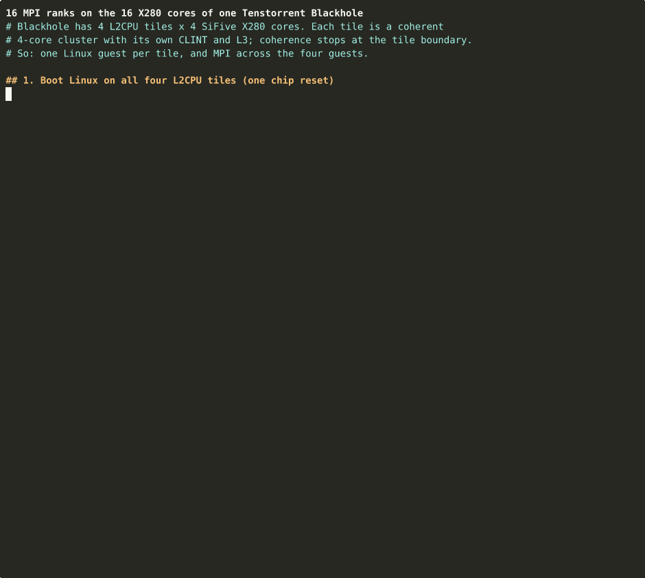

# MPI on all 16 X280 cores of one Blackhole

Run Open MPI across all 16 SiFive X280 cores of one Tenstorrent Blackhole p100/p150, with one rank per core.



*81 s recording (about 3 minutes in real time, idle time trimmed). Raw asciicast: [docs/demo16.cast](docs/demo16.cast).*

## Why four Linux guests

Blackhole's 16 X280 cores sit in four **L2CPU tiles** of four cores each. Each tile is a
cache-coherent cluster with its own CLINT, L3 and DRAM port. Coherence stops at the tile
boundary ([ISA docs: L2CPU tile](https://github.com/tenstorrent/tt-isa-documentation/tree/main/BlackholeA0/L2CPUTile)),
so one Linux image can never see more than 4 CPUs. `mpirun -np 16` inside one guest fails
with "not enough slots".

This demo boots **one Linux guest per tile** and runs MPI across the four guests, as if they
were four 4-core hosts:

```
   L2CPU 0           L2CPU 1           L2CPU 2           L2CPU 3
   bh-x280-0         bh-x280-1         bh-x280-2         bh-x280-3
   ranks 0-3         ranks 4-7         ranks 8-11        ranks 12-15
   4 GB (DRAM D5)    4 GB (DRAM D6)    2 GB (DRAM D7)    2 GB (DRAM D7)
      |                 |                 |                 |
      +------- lan0  10.80.0.0/24, Ethernet relayed by the host over PCIe ------+
```

- Ranks in the same guest use shared memory (Open MPI `sm`).
- Ranks in different guests use TCP over `lan0`, a second virtio-net NIC. The host tool relays its frames between guests.
- Each guest also has `eth0` (slirp NAT) for internet access and for ssh from the host.

## Results

Measured on a P150A with the scripts in this directory (Debian 13, Open MPI 5.0.7):

| Benchmark | 1 rank | 4 ranks | 8 ranks | 16 ranks |
|---|---:|---:|---:|---:|
| pi, 400 M steps (`demo/mpi_pi`) | 23.6 s | 5.90 s | 2.96 s | 1.49 s (15.8x) |

| Ping-pong from rank 0 (`demo/pingpong`) | 8 B one-way | 1 MiB bandwidth |
|---|---:|---:|
| Same tile (shared memory) | 6.4-7.9 us | 640-870 MB/s |
| Different tile (`lan0` via host) | 127-142 us | 51-52 MB/s |

Compute scales linearly across tiles. Communication between tiles is the expensive part:
every frame crosses PCIe twice and goes through the guests' TCP stacks. See
[Limitations](#limitations-and-next-steps).

## Quick start

### Requirements

- A Blackhole p100 or p150 with all four L2CPU tiles enabled. `boot.py` checks the harvesting mask and
  stops if a tile is missing. Nothing else may be using the card: booting resets the chip, and tt-bh-linux
  cannot run alongside tt-metal.
- Host: Ubuntu or Debian x86-64 with [tt-kmd](https://github.com/tenstorrent/tt-kmd) and the
  [tt-installer](https://github.com/tenstorrent/tt-installer) Python venv (`~/.tenstorrent-venv`, with pyluwen and tt-smi).
- Host packages: `sudo apt install libvdeslirp-dev libslirp-dev device-tree-compiler e2fsprogs tmux`,
  and `~/.tenstorrent-venv/bin/pip install pylibfdt`.
- About 8 GB of disk: five sparse 6 GB ext4 images (one base, four guests) of about 1.5 GB each.

### Build and provision (once)

From the repository root:

```sh
make build_hosttool                 # host tool with the changes described below
make download_prebuilt              # Image, fw_jump.bin, blackhole-card.dtb (release v0.11)
wget https://github.com/tenstorrent/tt-bh-linux/releases/download/v0.11/tt-bh-disk-image.zip
unzip tt-bh-disk-image.zip          # debian-riscv64.img

mpi16/prepare.sh                    # per-tile device trees, ssh keys, mpi16/out/base.ext4
mpi16/boot16.sh provision           # boot L2CPU 0 alone from base.ext4
ssh -p 2222 -i mpi16/out/host_key debian@localhost \
  'sudo apt-get update && sudo apt-get install -y openmpi-bin libopenmpi-dev && make -C demo && sudo poweroff'
mpi16/prepare.sh clone              # mpi16/out/rootfs-{0..3}.ext4
```

`prepare.sh` needs no root. It edits the ext4 image with `debugfs`.

### Run

```sh
mpi16/boot16.sh                     # boots all four tiles with one chip reset
tmux attach -t mpi16                # optional: the four consoles (Ctrl-b d to detach)
ssh -p 2222 -i mpi16/out/host_key debian@localhost
```

Then inside `bh-x280-0`:

```sh
mpirun --hostfile hostfile -np 16 --map-by core --bind-to core demo/hello_mpi
mpirun --hostfile hostfile -np 16 --map-by core --bind-to core demo/mpi_pi
mpirun --hostfile hostfile -np 16 --map-by core --bind-to core demo/pingpong
```

The guests are already set up for this: hostnames, `/etc/hosts`, passwordless ssh between guests,
and Open MPI restricted to `lan0`.

| Script | What it does |
|---|---|
| `mpi16/demo16.sh` | Narrated demo from a cold boot (the recording above). Record with `asciinema rec -i 2 -c mpi16/demo16.sh demo.cast`. |
| `mpi16/reboot16.sh` | Powers the guests off cleanly, reboots all four, and waits until `lan0` is up. |

To give the card back to tt-metal: `tmux kill-session -t mpi16 && tt-smi -r 0`.

## How it works

### Per-tile layout

| L2CPU | NoC (x,y) | Guest | DRAM base (X280 view) | Size | ssh from host | lan0 |
|---|---|---|---|---|---|---|
| 0 | (8,3) | bh-x280-0 | `0x4000_3000_0000` | 4 GiB (D5) | `localhost:2222` | 10.80.0.10 |
| 1 | (8,9) | bh-x280-1 | `0x4000_3000_0000` | 4 GiB (D6) | `localhost:2223` | 10.80.0.11 |
| 2 | (8,5) | bh-x280-2 | `0x4000_3000_0000` | 2 GiB (D7, low half) | `localhost:2224` | 10.80.0.12 |
| 3 | (8,7) | bh-x280-3 | `0x4000_b000_0000` | 2 GiB (D7, high half) | `localhost:2225` | 10.80.0.13 |

Each guest loads OpenSBI at its DRAM base, the device tree at +1 MiB and the kernel at +2 MiB.
`prepare.sh` writes the matching `memory` node into each tile's device tree. These values must
agree with `l2cpu_starting_address_mapping` and `l2cpu_memory_size_mapping` in `console/l2cpu.cpp`,
because the host derives the virtio register addresses from the same numbers. ssh ports are
`2222 + l2cpu + 4 * card`.

### Virtio devices

The host tool emulates virtio-mmio devices in the top 8 MiB of each guest's memory, which `boot.py`
marks as reserved:

| Slot (below end of RAM) | IRQ | Device |
|---|---|---|
| 2 MiB | 33 | virtio-blk: root disk (`--disk`) |
| 4 MiB | 32 | virtio-net: `eth0`, slirp NAT (`--network`) |
| 6 MiB | 31 | virtio-blk: cloud-init (`--cloud-init`, unused here) |
| 8 MiB | 30 | virtio-net: `lan0`, inter-guest LAN (`--lan <dir>`) |

### The inter-guest LAN

`--lan <dir>` binds a Unix datagram socket `<dir>/<card>-<l2cpu>.sock` in each host-tool process.
A frame sent on a guest's `lan0` goes to the peer that owns the destination MAC, learned from earlier
traffic; broadcast and unknown destinations go to every peer. The NIC has a fixed MAC
`02:74:74:00:<card>:<l2cpu>`. In the guest, systemd `.link` files rename it to `lan0` and `.network`
files give it a static address (`guest/10-lan0-*`).

## Changes to the host tool

All in this branch, on top of tt-bh-linux v0.11:

- **Shared 4 GiB windows** (`console/l2cpu.cpp`). The console and every virtio device each created an
  `L2CPU` object that mapped two of Blackhole's eight 4 GiB TLB windows, so one guest could use six and a
  second guest could not start. Windows are now shared per process, mapped on first use, and only for the
  part of the address space the tile's memory covers. Four guests need 2 + 2 + 1 + 2 = 7.
- **`--lan <dir>`** (`console/network.hpp`, `console/tt-bh-linux.cpp`). The second NIC, described above.
- **Faster virtio** (`console/virtiodevice.hpp`). The poll loop drains every ready descriptor before it
  sleeps, timer slack is set to 1 us, and guest buffers are read with 16-byte streaming loads (`movntdqa`)
  instead of `memcpy`. A 1514 B frame read over PCIe dropped from 67 us to 3.7 us, and cross-tile bandwidth
  went from 7 to 52 MB/s.
- **TX length fix.** When the virtio header and frame share a descriptor, the header is no longer counted
  as frame data. Before, a full-size frame overflowed the 1514 B buffer.
- **`boot.py`**: reserves all four virtio slots (8 MiB, was 6 MiB, which left the 4th slot as ordinary RAM),
  and `--hostname_prefix` sets each guest's hostname through `systemd.hostname=`.

## Talking to the Tensix cores

Tensix cores are not MPI ranks. They run TT-Metalium kernels, not Linux processes. An X280 process and a
Tensix kernel exchange data through buffers on the NoC:

- **X280 → Tensix.** Each L2CPU has 256 configurable [TLB windows onto the NoC](https://github.com/tenstorrent/tt-isa-documentation/blob/main/BlackholeA0/L2CPUTile/TLBWindows.md)
  that reach any Tensix L1 or DRAM bank. Use uncached windows for flags and doorbells; through cached
  windows, writes are only visible after the line is evicted or flushed.
- **Tensix → X280.** A kernel can write over the NoC into the tile's 2 MiB LIM scratchpad or the guest's
  DRAM, and raise a PLIC interrupt with a NoC write to the [MSI catcher](https://github.com/tenstorrent/tt-isa-documentation/blob/main/BlackholeA0/L2CPUTile/MSICatcher.md).
- **Bulk data.** Let Tensix push it. An X280 core handles one L1 data-cache miss at a time, so pulling
  over the NoC is slow.

This demo does not include an X280 ↔ Tensix example. tt-bh-linux and tt-metal cannot share a card today,
so a combined demo needs a Tensix kernel loaded without tt-metal resetting the chip.

## Troubleshooting

| Symptom | Cause and fix |
|---|---|
| `Failed to allocate TLB: Cannot allocate memory` | Another process holds 4 GiB TLB windows on the card (a tt-metal job, a monitor). Four guests need 7 of the 8. Stop it, then boot again. |
| `L2CPU n is harvested` | That tile is fused off on this part. Boot fewer tiles by editing `L2CPUS` in `boot16.sh`, and remove the host from `guest/hostfile`. |
| `apt-get update`: signature "Not live until …" | The guest has no RTC and booted with the image's build date. Wait for NTP, or run `sudo date -s @<host epoch>`. `demo16.sh` does this for you. |
| A guest takes over a minute to answer ssh | Normal on first boot after cloning, while the journal and ssh host keys settle. Watch it with `tmux attach -t mpi16`. |
| `mpirun` hangs between guests | Check `ping bh-x280-1` from `bh-x280-0`. Open MPI must stay on `lan0` (`~/.openmpi/mca-params.conf`, `~/.prte/mca-params.conf`), because `eth0` has the same address 10.0.2.15 on every guest. |

## Limitations and next steps

- **Transport between tiles.** Traffic goes X280 → host → X280. The tiles are not coherent with each other,
  but they can all reach each other's DRAM over the NoC. An MPI transport that uses DRAM rings written through
  the X280 TLB windows, with explicit cache flushes, would keep traffic on chip.
- **Host CPU.** The host tool polls and uses about 3 host cores per guest.
- **Resets.** Booting resets the whole chip, so all guests restart together. X280 harts cannot be put back into
  reset without another chip reset.
- **Experimental.** This builds on the tt-bh-linux demo, not on a supported product path.

## License

Apache-2.0, as the rest of tt-bh-linux.
